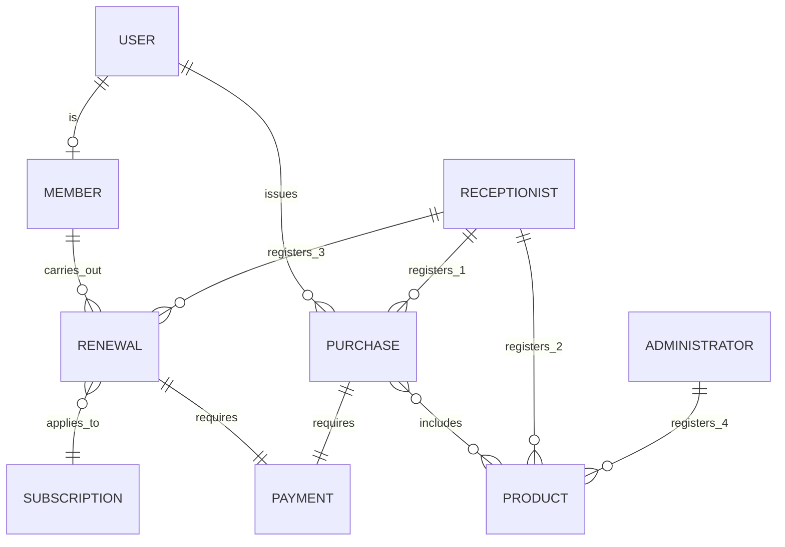

# Diagrama Entidad Relación del Modelo de Datos en Firebase

Versión 1.0.0

## Clasificación de Cambios
- Cambios mayores
  - Añadir, eliminar o renombrar colecciones
  - Añadir atributos no nulables
  - Eliminar atributos no nulables 
  - Renombrar atributos no nulables
  - Cambiar el tipo de dato de un atributo no nulo de forma no equivalente

- Cambios menores
  - Añadir atributos nulables
  - Eliminar atributos nulables 
  - Renombrar atributos nulables
  - Cambiar el tipo de dato de un atributo nulable

- Parches
  - Cambiar el tipo de dato de un atributo no nulable de forma equivalente (ej. double en vez de int)
  - Cambiar el tipo de dato de un atributo nulable de forma equivalente (ej. double en vez de int)
  - Cambios en la documentación o formato del documento

## Descripción del Modelo de Datos

